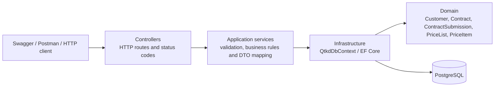

# Kiến trúc solution QTKD

## Thành phần

- `src/QTKD.Api/Controllers`: ánh xạ HTTP request tới service, trả status code và response phù hợp.
- `src/QTKD.Api/Application`: service/interface, DTO và quy tắc nghiệp vụ; không nhận hoặc trả trực tiếp EF entity.
- `src/QTKD.Api/Domain`: Customer, Contract, PriceList, PriceItem và ContractSubmission mô phỏng.
- `src/QTKD.Api/Infrastructure`: EF Core `QtkdDbContext`, quan hệ, unique index và dữ liệu seed.
- `src/QTKD.Api/Migrations`: lịch sử schema PostgreSQL; migration tuần 06 giữ migration `InitialCreate`.
- `tests/QTKD.Api.Tests`: unit test quy tắc không dùng database, service test dùng SQLite, và integration test gọi API qua WebApplicationFactory với SQLite riêng.

## Luồng gửi Contract US03

1. Client gọi `POST /api/contracts/{id}/submit`, có thể kèm `Idempotency-Key`.
2. `ContractsController` gọi `IContractCommandService`.
3. Service kiểm tra Contract tồn tại và đang `Draft`; tiếp đó kiểm tra Customer `Active`, khoảng ngày hiệu lực và `ServiceTerms`.
4. Nếu không đạt CTR-02, trả `400` cùng danh sách điều kiện thiếu; không thay đổi Contract và không tạo ContractSubmission.
5. Nếu đạt, trong transaction service cập nhật trạng thái có điều kiện `Draft` → `PendingApproval` và lưu một ContractSubmission mô phỏng. Mỗi Contract tối đa một submission và mỗi Idempotency-Key không-null chỉ dùng một lần
6. API trả `200` với `approvalId` mô phỏng. Approval workflow, phân công người duyệt và audit actor chưa được xây dựng.

## Giới hạn có chủ ý

- `ServiceTerms` là giả định demo cho “ít nhất một tệp/hạng mục nội dung bắt buộc”; upload file thực tế chưa có.
- AC01 chưa đạt vì ứng dụng chưa tích hợp authentication/authorization.
- Chưa có các bước phê duyệt, audit log người thực hiện, notification hoặc ký điện tử.

Kiểm chứng schema và API thật thực hiện theo [`verification.md`](./verification.md).
