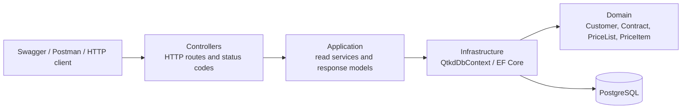

# Kiến trúc solution QTKD

## Thành phần

- `src/QTKD.Api/Controllers`: ánh xạ HTTP request tới dịch vụ đọc, trả `200` hoặc `404`.
- `src/QTKD.Api/Application`: read service và read model, tách response API khỏi entity persistence.
- `src/QTKD.Api/Domain`: các entity Customer, Contract, PriceList, PriceItem.
- `src/QTKD.Api/Infrastructure`: EF Core `QtkdDbContext`, cấu hình khóa, quan hệ và dữ liệu seed.
- `src/QTKD.Api/Migrations`: lịch sử tạo/cập nhật schema PostgreSQL.
- `tests/QTKD.Api.Tests`: kiểm thử unit response của controller.

## Luồng GET hợp đồng

1. Client gửi `GET /api/contracts/{id}`.
2. `ContractsController` gọi `IContractReadService`.
3. `ContractReadService` dùng EF Core truy vấn Contract và tên Customer.
4. Có kết quả thì controller trả `200 OK` cùng read model; không có thì trả `404 Not Found`.

Kiểm chứng kết nối PostgreSQL thực hiện theo [`verification.md`](./verification.md).
